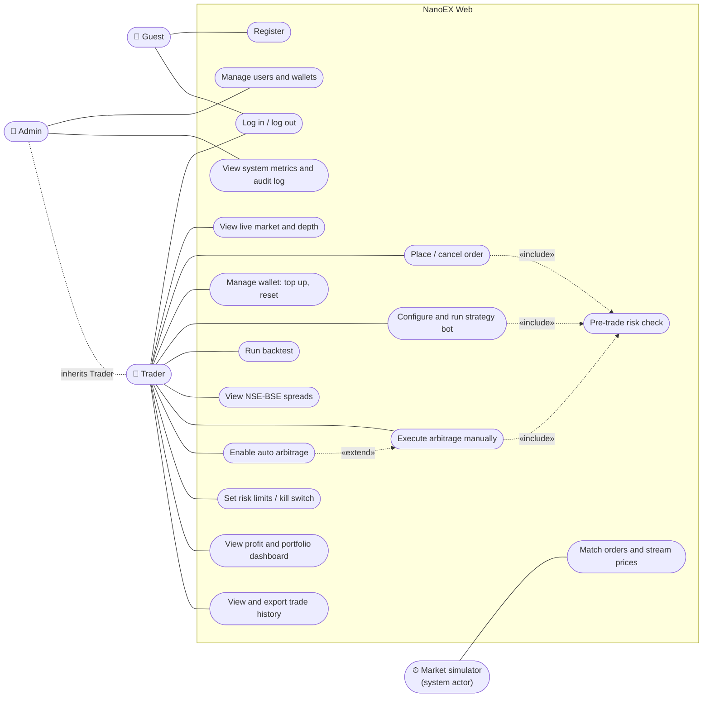
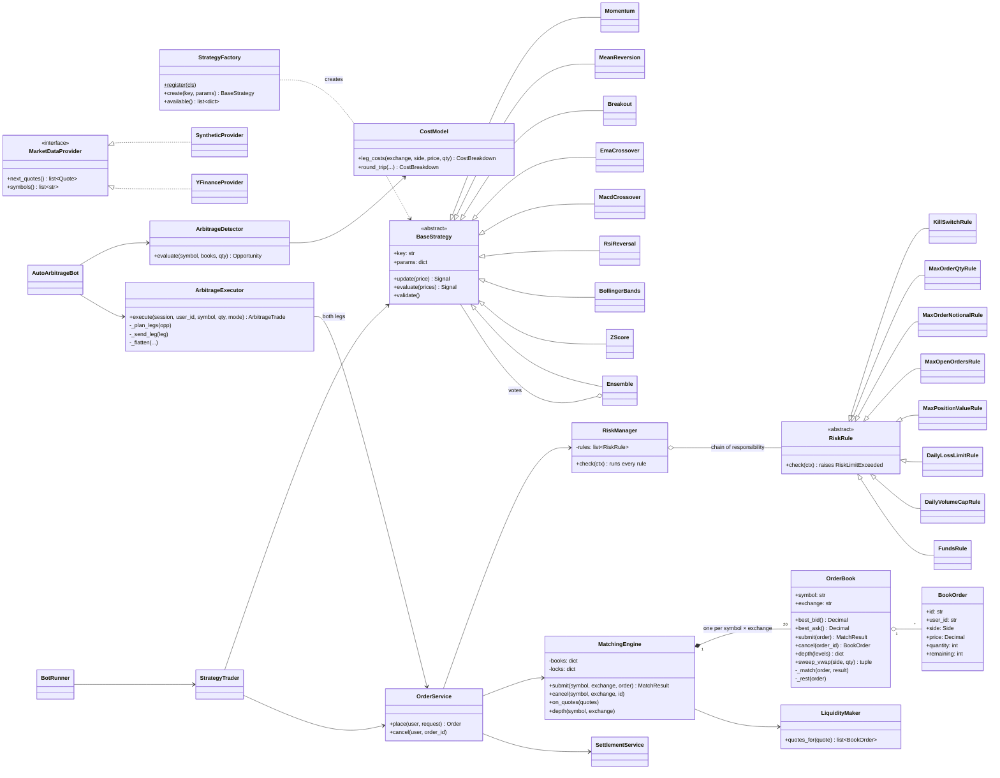
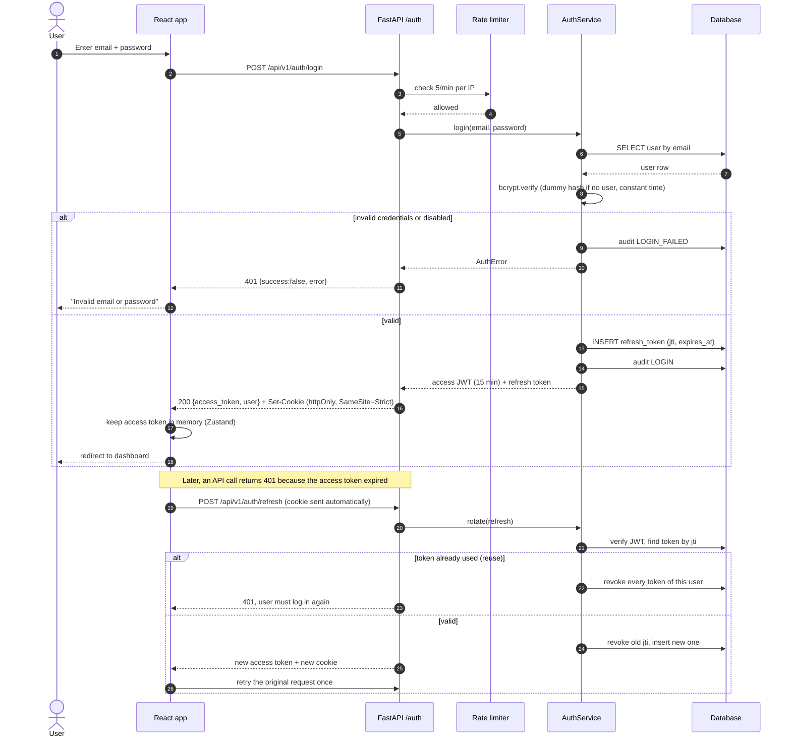
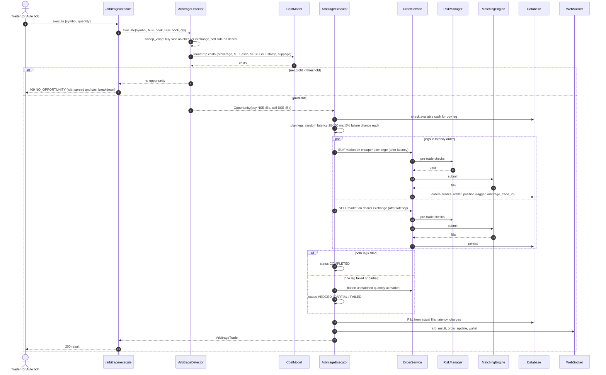
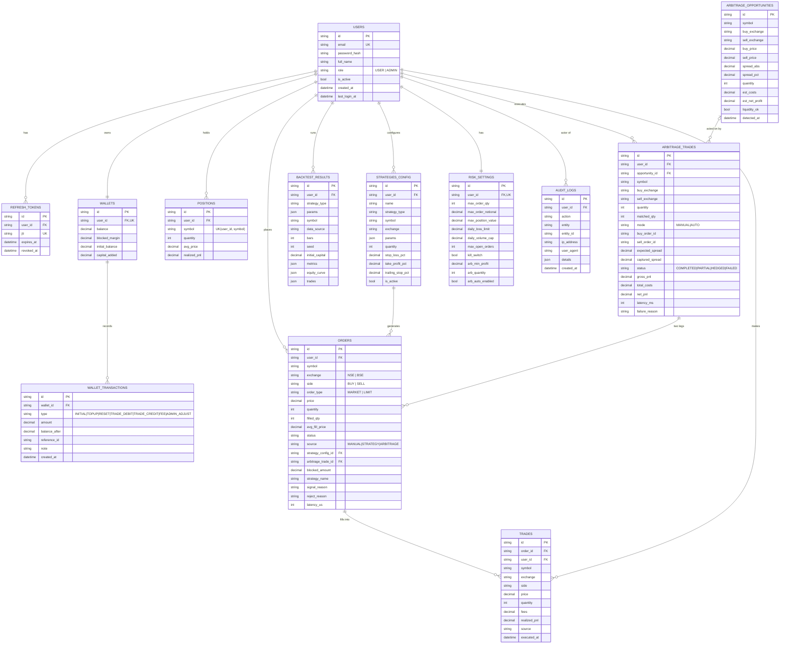
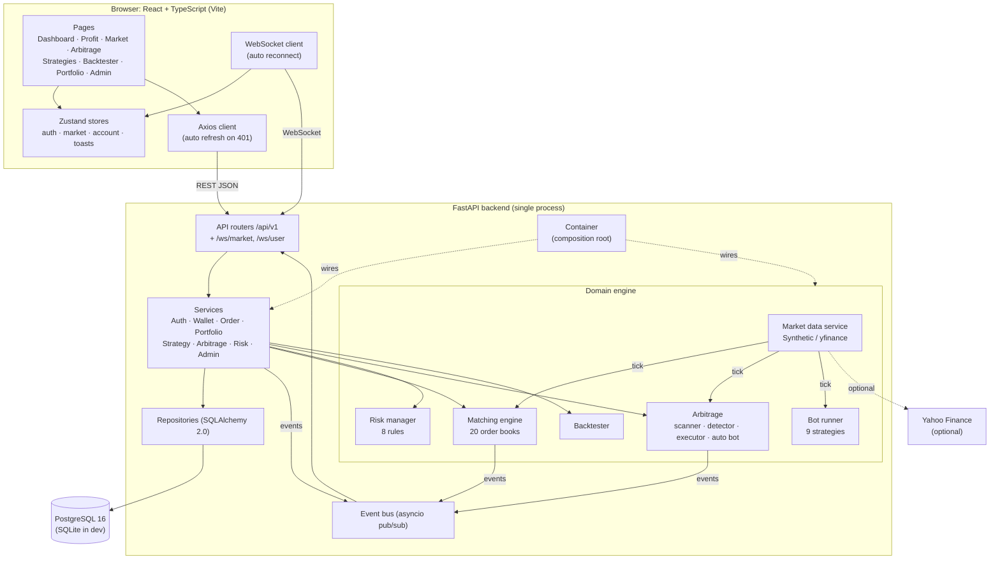
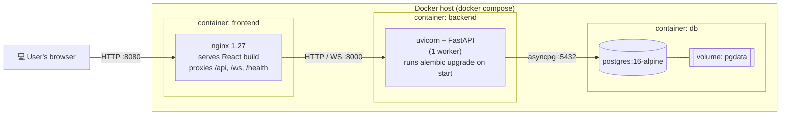

# UML diagrams: NanoEX Web

All diagrams are in Mermaid, so they render on GitHub, GitLab and in VS Code (with a Mermaid extension). Paste any block into <https://mermaid.live> to export it as PNG or SVG for a report.

## 1. Use case diagram

Mermaid has no native use-case notation, so actors are drawn as nodes and use cases as rounded boxes inside the system boundary.

## 2. Class diagram (core domain)

## 3. Sequence diagram: login and token refresh

## 4. Sequence diagram: NSE-BSE arbitrage execution

## 5. ER diagram

Every table also has `id` (UUID string), `created_at` and `updated_at`. Source of truth: `backend/app/models/` and `backend/alembic/versions/0001_initial_schema.py`.

## 6. Component diagram

## 7. Deployment diagram

Only port 8080 is published. The database and backend are reachable only on the internal Docker network. In production, put a TLS terminator (for example Caddy or a cloud load balancer) in front of nginx and set `COOKIE_SECURE=true`.
